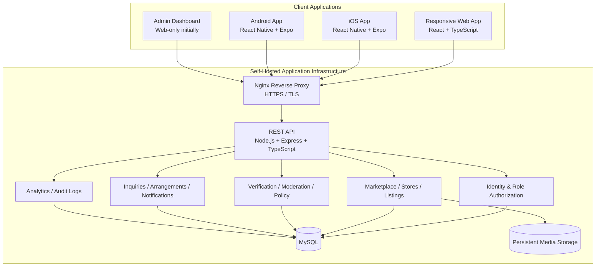
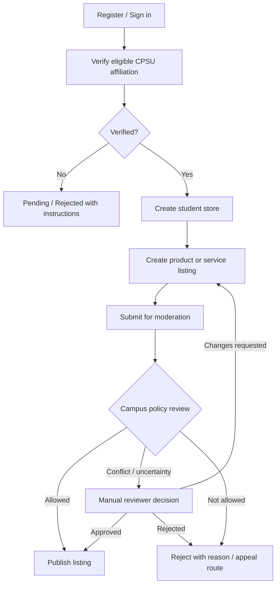
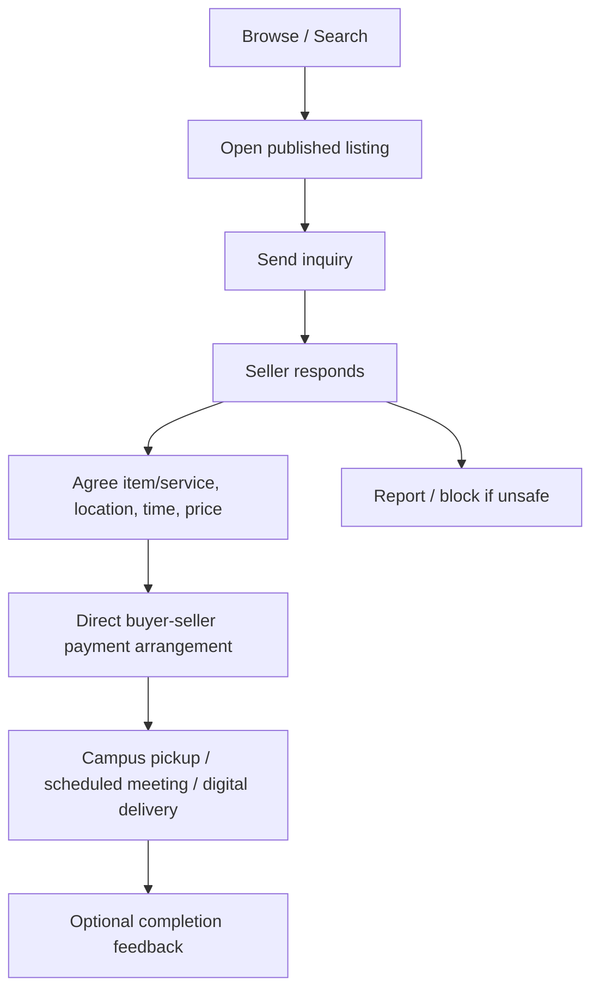
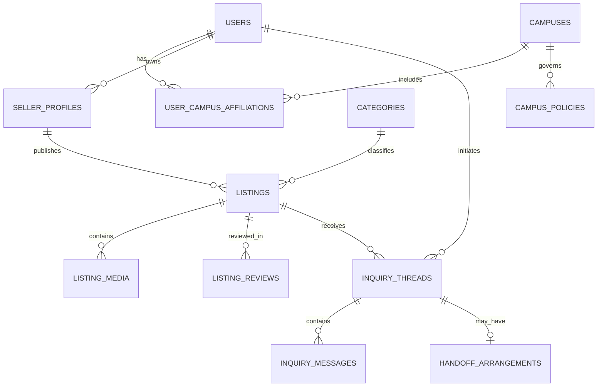

# CPSU Student Marketplace & Services
## Proposed System Architecture — Web, iOS, Android

> **Historical proposal (10 November 2026).** As of 12 November 2026 the implemented MVP uses a **single responsive web/PWA** for desktop and mobile browsers; Expo/React Native is archived, not active. This original three-client proposal is retained for design history only. See `docs/SYSTEM_OVERVIEW.md` and `docs/UNIFIED_WEB_PWA_2026-11-12.md` for the current architecture.

**Document status:** Proposed architecture for discussion; not a statement of existing CPSU policy or implemented functionality.  
**Version:** 1.0  
**Date:** 10 November 2026  
**Deployment approach:** Self-hosted modular monolith, shared REST API, shared relational database.

---

## 1. Executive Summary

The **CPSU Student Marketplace & Services** is a university-supported marketplace concept for student-made products, pre-loved items, and student-provided professional and creative services. It is designed to **complement, not displace, existing campus canteens, cooperatives, concessionaires, and other establishments**.

The system has three user-facing clients:

1. **Responsive website** for shoppers, sellers, and administrators.
2. **iOS mobile app** for students and sellers.
3. **Android mobile app** for students and sellers.

All clients use **one HTTPS REST API, one database, and shared business rules**. The university-facing management console is web-first. The mobile apps focus on student buying, selling, browsing, and inquiries.

**Initial business rules:** Free student registration and listings; no in-app payment gateway, commission, or courier dispatch in v1; seller-coordinated payment, campus pickup, scheduled meet-up, or off-campus arrangements subject to university policy; manual administrative review of potentially conflicting or restricted listings.

> All institutional roles, verification methods, operating rules, and permitted sale categories must be approved by CPSU before launch. Verified student identity must not imply university endorsement of a product or service.

## 2. System Context and High-Level Architecture



### Architecture style

- **Modular monolith:** One backend deployment separated into clear feature modules. Easier to maintain and deploy than microservices for a campus pilot.
- **API-first:** Clients never access MySQL directly; all access is validated through API endpoints.
- **Shared source of truth:** The same seller account, listing approval status, and inquiry are visible across platforms according to permissions.
- **Web-first administration:** University staff manage verification, policy decisions, and reports in a browser; no separate admin mobile app needed initially.
- **Campus-aware:** Users and listings can be associated with participating campuses; filtering and access are explicit.

## 3. Recommended Technology Stack

| Layer | Recommendation | Why |
|---|---|---|
| Web frontend | React + TypeScript + Vite | Fast responsive site; clear separation from API |
| Mobile | React Native + Expo + TypeScript | One mobile codebase for iOS and Android |
| Styling | Tailwind CSS for web; React Native styles/theme tokens for mobile | Consistent design system without forcing identical UI libraries |
| Backend | Node.js + Express + TypeScript | One centralized REST API for all clients |
| Database | MySQL 8 | Relational consistency for users, listings, campuses, approval history |
| DB access | Prisma ORM, pinned and tested version | Schema migrations, typed queries |
| Validation | Zod at API boundaries | Consistent input validation and errors |
| Authentication | Server-side identity verification, short-lived access credentials, rotating refresh sessions | Supports secure web and mobile sessions |
| Web credentials | Secure, HttpOnly, SameSite cookies with CSRF protections as appropriate | Limits exposure of session material |
| Mobile credentials | Platform secure storage for session secrets | Avoid storing secrets in plain app storage |
| Media | Restricted upload service + persistent disk/object-compatible self-hosted storage | Product images without requiring commercial media providers |
| Reverse proxy | Nginx + HTTPS | TLS and request routing |
| Deployment | Ubuntu VPS, process manager/systemd, MySQL backups | Self-hostable pilot and growth path |
| Testing | Bun test runner, Supertest, component tests, mobile E2E later | Verify behavior and critical security boundaries |

**Important:** The proposed stack is a choice, not a pre-existing requirement for this new CPSU project. If university IT has approved hosting, identity, database, or procurement standards, align with those before implementation. Expo tooling and mobile app distribution may involve vendor services or platform developer accounts; a self-hosted API does not eliminate those requirements.

## 4. Roles and Permission Model

| Role | Main permissions | Limits |
|---|---|---|
| Visitor | Browse publicly approved stores, listings, and marketplace guidelines | No private inquiries or student-only data |
| Student Buyer | Save listings, send inquiries, submit reports, manage own profile | Cannot approve listings or read others' inquiries |
| Verified Student Seller | Create/edit own store, submit listings, respond to inquiries, see own metrics | Cannot self-approve or bypass restrictions |
| Approved Campus Establishment | Manage its own separately labeled establishment profile and approved listings | Separate eligibility and institutional approval rules |
| Campus Reviewer | Review sellers/listings assigned to a campus, provide reasons and decisions | No unrestricted global admin access |
| University Admin | Manage categories, policy rules, reviewer assignments, reports, disputes | Access only to authorized operational data |
| System Administrator | Operate infrastructure and access-control configurations | Does not override business approval without audited authorization |

A person may be both buyer and seller. Implement **role-based permissions plus ownership and campus scope** on every protected endpoint. Never trust a role or campus ID supplied by the client.

## 5. Core Modules

### 5.1 Identity, registration and verification

- Signup and login; university-managed email verification **where available**, otherwise designated staff verification of student eligibility.
- Student identity status: `unverified`, `pending`, `verified`, `rejected`, `suspended`.
- Optional re-verification or expiration for graduation/inactive enrollment, subject to policy.
- Staff approvals and denials require reason, reviewer, timestamp, and audit trail.
- Public seller badges state **“Verified CPSU community member”** only when warranted. They must not claim product quality or official university endorsement.

### 5.2 Marketplace discovery

- Product listings, services listings, student businesses, and optional approved-campus-establishment directory.
- Search by keywords, category, campus, seller type, price range, and availability.
- Separate presentation for **Student Marketplace** and **Campus Establishments** to avoid confusing institutional and individual sellers.
- Featured student businesses, recently added products, popular services; popularity based on defined metrics, not fabricated sales counts.

### 5.3 Storefront and listing management

- One seller profile/store initially per eligible seller; expand to organizations/business teams later if approved.
- Listing types: `physical_product` and `service`.
- Details: name, description, price/pricing basis, images, campus coverage, category, availability, preferred handoff/service delivery, seller contact preference.
- Listings follow moderation states; published records exposed to public clients only if allowed by policy.
- If approved content changes materially, require re-review according to policy (e.g., item category or description changes).

### 5.4 Campus business protection / policy review

The attached concept specifically requires the platform **not to undermine existing campus establishments**. Treat this as a central design constraint, not an afterthought.

**Suggested classification:**

1. Student-created goods and pre-loved items — eligible for listing, subject to general review.
2. Skills-based student services — eligible, subject to campus and academic integrity policies.
3. Food, drinks, commercial school supplies, printing, or other categories potentially overlapping authorized on-campus establishments — **manual administrative review or restriction under formally approved rules**.
4. Existing establishments — may opt into a distinct directory after approval.

Automated rule checks may **flag possible conflicts** but must not invent contractual restrictions or make unappealable decisions. A designated CPSU reviewer makes the approval decision with a documented reason. Campus-specific policy versions and effective dates should be stored.

### 5.5 Inquiry and fulfillment coordination

**MVP recommendation:** Internal, asynchronous **inquiry threads** (not a full real-time chat product).

- Buyer opens inquiry with seller for an approved listing.
- Seller replies and agrees on details and a safe meeting/pickup or service delivery arrangement.
- Contact details only revealed according to privacy settings and consent.
- Payment is arranged directly between parties; the platform **does not hold funds or verify payment automatically**.
- Product handoffs: campus pickup, scheduled meeting, seller-arranged delivery, or off-campus delivery when allowed.
- Services: remote digital delivery or scheduled appointment.
- Optional outcome record: `completed`, `cancelled`, `not_confirmed` reported by a party; not treated as a verified sale unless evidence and a reconciliation procedure exist.

### 5.6 Reporting, notifications and analytics

- Reporting of listing, seller, misconduct, or prohibited item.
- Moderation queue and reasons for decisions.
- In-app notification center for account verification, listing decisions, inquiries, and reports.
- Email or mobile push **may be added later** if institution-approved service integrations are available; do not make critical functionality depend on push delivery.
- Aggregate dashboards by campus: approved sellers, active storefronts, published listings, inquiries, flagged listings, service providers, and confirmed outcomes only where genuinely tracked.
- Suppress small-count analytics where they could expose an individual student.

## 6. User Flows

### 6.1 Student seller onboarding



### 6.2 Buyer inquiry and handoff



### 6.3 Review workflow

1. New listing enters `pending_review`.
2. Rules engine flags sensitive category, campus scope, missing required data, and potential establishment overlap.
3. Authorized campus reviewer checks policy and decides `approved`, `changes_requested`, or `rejected`.
4. Decision is logged with reviewer, reason, policy reference/version, and timestamp.
5. On approval, listing becomes `published`; seller receives an in-app notification.
6. Sellers can submit an appeal if provided in adopted rules.
7. Admin may suspend or unpublish a listing after verified policy or safety concerns, with an auditable reason.

## 7. Database Design (MVP)

| Table | Key columns / purpose |
|---|---|
| `users` | id, name/display_name, email, password_hash or identity_provider_ref, status, created_at |
| `campuses` | id, code, name, active |
| `user_campus_affiliations` | id, user_id, campus_id, verification_status, verified_at, expiration_at |
| `user_roles` | user_id, role, campus_id nullable, assigned_by |
| `sessions` | id, user_id, refresh_token_hash, expires_at, revoked_at, device metadata |
| `seller_profiles` | id, owner_user_id, seller_type, store_name, description, campus_id, approval_status |
| `categories` | id, parent_id, name, listing_type, policy_risk_level |
| `listings` | id, seller_profile_id, category_id, type, title, description, price, currency, status, campus_scope, created_at |
| `listing_media` | id, listing_id, media_path, mime_type, position, moderation_status |
| `listing_reviews` | id, listing_id, reviewer_id, decision, reason, policy_version_id, created_at |
| `campus_policies` | id, campus_id, version, effective_date, approved_by, rules/document reference |
| `restricted_categories` | id, campus_id, category_id, policy_action, policy_version_id |
| `inquiry_threads` | id, listing_id, buyer_user_id, seller_profile_id, status |
| `inquiry_messages` | id, thread_id, author_user_id, body, created_at |
| `handoff_arrangements` | id, inquiry_thread_id, method, time_window, general_location, status |
| `reports` | id, reporter_user_id, listing_id or seller_profile_id, reason, status, assigned_reviewer_id |
| `notifications` | id, user_id, type, payload, read_at |
| `audit_logs` | id, actor_user_id, action, target_type, target_id, metadata, occurred_at |

**Modeling rules:** Index `listings(status, category_id, campus_scope, created_at)` and inquiry ownership fields; use foreign keys and migrations; keep personal verification documents in access-controlled storage if ever collected; don't expose private student records in public seller APIs. For v1, use a single `listings` table with type-specific validation and optional attributes instead of separate redundant marketplace backends.

### Entity relationships (simplified)



## 8. API Design (illustrative v1)

All endpoints are under `/api/v1`. Public endpoints expose only approved information.

| Endpoint | Method | Authorized use |
|---|---|---|
| `/auth/register` | POST | Start registration |
| `/auth/login` | POST | Authenticate |
| `/auth/refresh` | POST | Rotate session |
| `/auth/logout` | POST | Revoke session |
| `/me` | GET/PATCH | Own profile |
| `/campuses` | GET | Participating campuses |
| `/categories` | GET | Public approved categories |
| `/listings` | GET | Search published listings |
| `/listings/:id` | GET | View published listing, or own authorized draft |
| `/seller-profiles/:id` | GET | Approved public storefront |
| `/seller/listings` | GET/POST | Own listings |
| `/seller/listings/:id` | PATCH | Own draft/eligible listing |
| `/seller/listings/:id/submit` | POST | Submit for review |
| `/inquiries` | GET/POST | Buyer/seller scoped threads |
| `/inquiries/:id/messages` | GET/POST | Participants only |
| `/reports` | POST | Report content or account |
| `/admin/review-queue` | GET | Authorized reviewers by campus |
| `/admin/listings/:id/decision` | POST | Reviewer approval, rejection, changes request |
| `/admin/sellers/:id/verify` | POST | Authorized affiliation verification |
| `/admin/analytics/overview` | GET | Authorized aggregate dashboard |
| `/notifications` | GET | Own notifications |

**API conventions:** pagination, search and filter validation, rate limiting, consistent error codes, audit logging for privileged actions, and versioned schemas. Image uploads have strict size/type validation, private staging, safe content serving, and separate permissions from user profile edits.

## 9. Platform UX and Navigation

### Public website

- Home / Discover: student marketplace, campus filter, search, selected student enterprises.
- Product Catalog and Services Catalog.
- Storefront: business name, seller type, campus, approved offerings, pricing, inquiry entry.
- Guidelines: selling policy, campus business protection, pickup guidance, reporting.
- Login / registration and student account.

### Student dashboard — web and mobile

- My account, affiliation status.
- My storefront, listings, media, listing statuses.
- Inquiries, notifications, saved items.
- Basic activity statistics, report an issue.

### University admin dashboard — web-first

- Review queues: affiliations, stores, and listings.
- Policy management: campus/category-specific rules with audit history.
- Complaint and appeal management.
- Operational dashboard, campus-level aggregate reporting, export with privacy restrictions.
- Staff roles, permissions, and audit logs.

### Mobile navigation proposal

**Explore | Categories | Inquiries | Saved | Profile**. Seller tools appear from Profile as a dedicated workspace. Keep onboarding and browsing fast on low-bandwidth phones; allow image compression before upload and paginate results.

## 10. Suggested Repository Structure

```text
cpsu-student-marketplace/
  apps/
    web/                 # React + TypeScript public site and admin
    mobile/              # Expo + React Native, iOS and Android
    api/                 # Node.js + Express REST service
  packages/
    contracts/           # Shared Zod API schemas and types
    config/              # Shared lint, TypeScript, design tokens
  infrastructure/
    nginx/
    deploy/
    backup/
  docs/
    architecture.md
    roles-and-permissions.md
    campus-policy-rules.md
    privacy-and-retention.md
  package.json           # npm workspaces
```

The `mobile/` folder builds two native apps from one React Native codebase. The `web/` app and mobile app **share data contracts and design tokens**, not all component code. This avoids forcing web-specific UI into native screens.

## 11. Hosting, Operations, and Data Flow

```text
Student phone/browser
   → HTTPS (Nginx)
   → Express API (private host port)
   → MySQL (private network/local connection)
   → Persistent media directory (restricted write path)

University admin browser
   → HTTPS (Nginx)
   → Same API with campus-scoped authorization and audited actions
```

- Separate development, staging, and production databases/environment variables.
- MySQL must not have a publicly accessible database port.
- Use encrypted TLS in transit, least-privilege database users, protected secrets, and production environment configuration.
- Back up MySQL and uploaded media with restore testing; database-only backup is insufficient for photos.
- Set image file limits, compression, account quotas, media review, and disk alerts. Storage can become a major recurring cost as the marketplace grows.
- Have uptime monitoring, server resource alerts, migration rollback strategy, and documented incident response.
- Ensure the website uses semantic, accessible forms and the native apps accommodate screen readers and varying screen sizes.
- Support unstable connections with retries and explicit pending/error states, not offline financial transactions.
- Publishing mobile apps requires meeting current Apple/Google distribution and privacy policies, outside the server architecture itself.

## 12. Privacy, Safety, and Governance

- CPSU or the designated operating organization must establish legal basis, privacy notice, terms, retention schedules, and data processing responsibilities under applicable Philippine rules, including the Data Privacy Act of 2012.
- Avoid displaying student IDs, personal email addresses, class schedules, phone numbers, or exact whereabouts publicly.
- Collect the minimum information needed for identity eligibility and marketplace operations.
- Use secure password hashing (e.g., Argon2id), account lockout/rate limits, session revocation, and authorization checks on every read/write.
- Use restricted moderation views for reports and messages; document the exact conditions under which staff can access private inquiry content.
- Define banned items, academic-integrity restrictions (including paid cheating/impersonation), food/health requirements, prohibited harassment, campus pickup locations, and complaints handling.
- Sellers should not be required to photograph or publicly disclose their student ID; verification should use a protected workflow if needed.
- Store review decisions, role changes, suspensions, and policy modifications in tamper-evident audit history.
- Consent for optional notifications, and clear controls to report or block sellers/buyers.

## 13. MVP Scope and Deferred Features

### MVP: Build first

1. Responsive discovery website and an Expo mobile app for both iOS/Android.
2. Registration, sign-in, affiliation verification, and role permissions.
3. Student storefronts and product/service listings.
4. Campus filters, search, categories, and listing images.
5. Approval, conflict flagging, reviewer notes, audit records.
6. Inquiries and an in-app notification center.
7. University admin dashboard and basic campus aggregate statistics.
8. Policy, privacy, reporting, and dispute information pages.

### Defer until validated

- Wallet, escrow, built-in payment processing, commission calculation.
- Courier routing, live delivery tracking, or on-campus dispatch networks.
- Real-time chat, voice/video calls, automatic contact sharing.
- Student identity integration with university SIS/SSO unless officially supported.
- Ratings/reviews until transactions can be meaningfully validated and abuse controls exist.
- AI recommendations, complex personalization, cross-campus logistical guarantees.
- Native admin apps, microservices, event buses, Kubernetes.

## 14. Implementation Roadmap

| Stage | Deliverables | Gate to proceed |
|---|---|---|
| 0 — Governance | CPSU stakeholder consultation; campus establishment constraints; approved selling rules; defined eligibility, privacy, dispute processes | Written policy and authorized owners |
| 1 — Foundation | Repository, schema, roles, authentication, campus model, deployment environments, test harness | Authentication/authorization and backups tested |
| 2 — Marketplace web | Browsing, sellers, listings, media, campus filters, responsive screens | Functional, accessible web pilot |
| 3 — Review and inquiries | Verification queue, listing moderation, policy flags, inquiry threads, audit | End-to-end approval and report cases pass |
| 4 — Mobile | Expo iOS/Android client against same API, accessibility, secure session storage | Tests on real devices; app distribution readiness |
| 5 — Pilot | Recruit approved sellers and campus reviewers; training, monitoring, feedback | Measured usefulness, safety, platform reliability |
| 6 — Expansion | More campuses, directory of approved establishments, governance revisions, performance optimization | Demonstrated demand and institutional approval |

**Pilot planning targets** from the concept note (not measured baseline): 20 verified sellers, 10 service providers, 50 listings, three participating colleges, and 100 buyers. Validate capacity and usefulness rather than treating these numbers as mandatory achievement targets.

## 15. Definition of Done and Validation

- A buyer on Android can discover the same approved listing available to a buyer on iOS or web.
- A seller's draft cannot appear publicly before approval.
- A seller cannot edit another seller's listing or read another user's inquiry.
- A campus reviewer cannot act outside authorized campus scope.
- A potentially conflicting canteen/printing/food listing enters the approved policy review path and is not auto-endorsed.
- A rejection includes a documented reason and does not leak private student information.
- Logged-out users cannot access restricted API routes.
- MySQL failure and media upload failure produce recoverable errors, not silent data loss.
- Database and media restore procedures have been exercised successfully.
- Campus analytics are aggregated, correctly labeled, and cannot imply unverified completed sales.
- Product discoverability, navigation and inquiries work acceptably on low-end phones and slower networks.

## 16. Decisions CPSU Must Confirm Before Development

1. What student identity source is permitted: official email, registrar-assisted validation, or staff verification?
2. Which campus, office, or appointed committee authorizes student sellers and restricted categories?
3. Which products and services are allowed, review-only, or prohibited across campuses?
4. Can authorized campus establishments participate, and under which storefront category?
5. Are inquiries allowed entirely in-app, or must users use approved external contact channels?
6. Which approved campus pickup zones or off-campus handoffs are permitted?
7. Where must personal data and media be hosted, and what retention/deletion requirements apply?
8. Who owns/operates the service, responds to reports, and approves app distribution?

---

### Proposed Architecture Decision

**Use a single modular Node.js/Express API, MySQL, React web app, and React Native/Expo mobile app for iOS and Android.** Deploy on approved HTTPS infrastructure, build a web-first university admin console, and make **campus-aware approval and business-protection policy** a core module from day one. Avoid payments, couriers, and microservices in the initial pilot.

*Prepared from the supplied CPSU Student Marketplace & Services concept, with technical implementation recommendations added. This is a proposed blueprint and does not imply CPSU institutional approval.*
